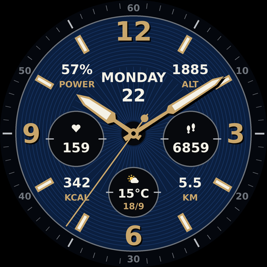

# Forerunner Chrono – Garmin Connect IQ watch face

An analog chronograph-style watch face inspired by the Garmin fenix/epix premium dial:
gold sword hands with lume, applied baton indices, big 12/3/6/9 numerals, and three sub-dials.



| Position | Shows |
|---|---|
| Top centre | Day of week + date |
| Left sub-dial | Heart rate (live, or the most recent reading) |
| Right sub-dial | Steps today |
| Bottom sub-dial | Weather: icon, temperature, high/low |
| 10:30 | Battery % ("POWER") |
| 1:30 | Altitude (m or ft, follows your watch settings) |
| 7:30 | Calories today |
| 4:30 | Distance today (km or mi) |

Settings (in the Garmin Connect app → your watch face → Settings):
- **Dial color**: Blue / Black (`docs/preview_black.png`)
- **Show second hand**: on / off

On AMOLED watches (FR165/265/965) the always-on mode switches to a dim outline face that
moves a few pixels to protect the screen from burn-in.

## Supported watches
FR165, FR245, FR255 (all variants), FR265/265S, FR745, FR945/945 LTE, FR955, FR965.
The layout scales to any round screen. To add another model (for example FR570/FR970), open
`manifest.xml` in VS Code and run **Monkey C: Edit Products**.

## Build the `.prg` (one-time setup, about 10 minutes)
1. Install the **Connect IQ SDK Manager** from https://developer.garmin.com/connect-iq/sdk/ ,
   sign in, download the latest SDK, and under **Devices** download your Forerunner model.
2. Install **VS Code** and the **Monkey C** extension (by Garmin).
3. In VS Code, open the command palette (Ctrl/Cmd+Shift+P) and run
   **Monkey C: Generate a Developer Key** (do this once, and keep the key file).
4. Open this `garmin-watchface` folder in VS Code.
5. Optional: run **Monkey C: Run** to see the face in the simulator.
6. Run **Monkey C: Build for Device**, pick your watch (for example `fr265`), and choose an
   output folder. You get a file like `garmin-watchface.prg`.

Command-line alternative:
```
monkeyc -d fr265 -f monkey.jungle -o ForerunnerChrono.prg -y /path/to/developer_key.der
```

## Put it on the watch (sideloading)
1. Connect the watch to your computer with the USB cable.
   - Windows: it shows up as a drive / device in Explorer.
   - Mac: install **OpenMTP** (https://openmtp.ganeshrvel.com/) to browse the watch.
2. Copy the `.prg` file into the folder **`GARMIN/APPS`** on the watch.
3. Unplug the watch. On the watch, hold **UP** (or long-press the watch face) → **Watch Face**
   → scroll to **Forerunner Chrono** → **Apply**.

Note: sideloaded faces don't show up in the Garmin Connect app's settings screen. To change the
dial color you can either publish the face (privately or in beta) on the Connect IQ Store,
or change the default in `resources/settings/properties.xml` and rebuild.

## Preview
`python3 tools/preview.py docs resources/drawables` re-renders the preview images and the
launcher icon (needs Pillow). It is an approximation; fonts on the watch differ.
